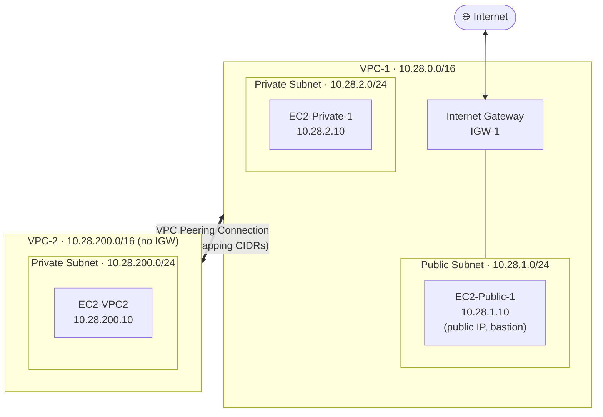

<div align="center">

# ☁️ CloudLink

### AWS VPC Peering — Cloud Networking Dashboard

**Design it. Build it. Track it. Prove it.**
A full-stack dashboard that documents, visualizes and tracks a real AWS VPC Peering deployment — two isolated VPCs, public and private subnets, custom route tables, and cross-VPC connectivity verified over private IPs.

<br />


[Overview](#-overview) · [Architecture](#-network-architecture) · [Features](#-features) · [Quick Start](#-quick-start) · [API](#-api-reference) · [Deployment](#-deployment) · [Roadmap](#-roadmap)

</div>

---

## 📖 Overview

**CloudLink** is the companion dashboard for an AWS cloud-networking internship project. The project builds a **VPC Peering** topology in the AWS Console, and this application turns that work into something you can *see*, *follow* and *measure*:

- an **interactive SVG topology** of the whole network,
- a **20-step implementation guide** with persistent progress,
- a **resource tracker** (full CRUD) for every AWS object you create,
- a **connectivity test log** for ping / SSH results across VPCs, with latency and packet-loss stats,
- a **live stats dashboard** that rolls it all up into a completion percentage.

The UI is a dark, AWS-orange **glassmorphism** design built with plain CSS (`backdrop-filter`) — no UI framework.

---

## 🌐 Network Architecture

Everything below is deployed in **`ap-south-1` (Mumbai)**.



### IP plan

| Resource | Type | CIDR / IP | Notes |
|---|---|---|---|
| `VPC-1` | VPC | `10.28.0.0/16` | Primary VPC, 65,536 addresses |
| `Public-Subnet-1` | Subnet | `10.28.1.0/24` | Routes `0.0.0.0/0` to the IGW |
| `Private-Subnet-1` | Subnet | `10.28.2.0/24` | No direct internet access |
| `VPC-2` | VPC | `10.28.200.0/16` | Secondary VPC, peered with VPC-1 |
| `Private-Subnet-2` | Subnet | `10.28.200.0/24` | Reachable only through peering |
| `EC2-Public-1` | EC2 | `10.28.1.10` | Bastion / jump host with public IP |
| `EC2-Private-1` | EC2 | `10.28.2.10` | Accessed via the bastion |
| `EC2-VPC2` | EC2 | `10.28.200.10` | Cross-VPC target |

> **Why these CIDRs?** VPC peering requires **non-overlapping** address spaces. `10.28.0.0/16` and `10.28.200.0/16` share the `10.28` prefix but never collide.

### Route tables

| Route table | Associated subnet | Destination | Target |
|---|---|---|---|
| `RT-Public-1` | Public-Subnet-1 | `10.28.0.0/16` | local |
| | | `0.0.0.0/0` | Internet Gateway |
| | | `10.28.200.0/16` | VPC Peering (`pcx-…`) |
| `RT-Private-1` | Private-Subnet-1 | `10.28.0.0/16` | local |
| | | `10.28.200.0/16` | VPC Peering (`pcx-…`) |
| `RT-Private-2` | Private-Subnet-2 | `10.28.200.0/16` | local |
| | | `10.28.0.0/16` | VPC Peering (`pcx-…`) |

Routing is explicit in **both** directions — without the return route in `RT-Private-2`, traffic would only flow one way.

### Security group rules (inbound, minimum required)

| Instance | Protocol | Source | Purpose |
|---|---|---|---|
| `EC2-Public-1` | SSH (22) | `0.0.0.0/0` | Admin access from the internet |
| `EC2-Public-1` | ICMP | `0.0.0.0/0` | Ping from the internet |
| `EC2-Private-1` | SSH (22) | `10.28.1.0/24` | SSH from the public subnet only |
| `EC2-Private-1` | ICMP | `10.28.0.0/16` | Ping within VPC-1 |
| `EC2-VPC2` | SSH (22) | `10.28.0.0/16` | SSH from VPC-1 via peering |
| `EC2-VPC2` | ICMP | `10.28.0.0/16` | Ping from VPC-1 |

> 🔐 For anything beyond a lab, restrict the `0.0.0.0/0` SSH rule on `EC2-Public-1` to your own IP.

### Verified connectivity

| Source | Destination | Protocol | Result |
|---|---|---|---|
| `EC2-Public-1` (10.28.1.10) | `EC2-Private-1` (10.28.2.10) | ICMP | Same-VPC path |
| `EC2-Public-1` (10.28.1.10) | `EC2-VPC2` (10.28.200.10) | ICMP | ✅ Cross-VPC over peering — **1.2 ms, 0 % packet loss** |
| `EC2-Private-1` (10.28.2.10) | `EC2-VPC2` (10.28.200.10) | ICMP | Cross-VPC from the private subnet |
| `EC2-VPC2` → VPC-1 hosts | | ICMP | Return path |

The dashboard ships with the cross-VPC ping above already logged (see `backend/db/vpc_dashboard.json`).

---

## ✨ Features

| Page | Route | What it does |
|---|---|---|
| 🏠 **Home** | `/` | Hero, compact topology preview, **overall completion bar**, stat cards (total / active resources, tests logged, average latency), resources-by-VPC and connectivity summaries |
| 🗺️ **Architecture** | `/architecture` | Four tabs — **Diagram**, **CIDR Table**, **Route Tables**, **Security Groups** — plus a peering traffic-flow strip |
| 📋 **Step Guide** | `/guide` | **20 console-level steps** across 5 phases (*Setup · VPC 1 · VPC 2 · Peering · Verify*) with exact values, copy-ready commands and a tip per step. Filter by phase; progress persists in `localStorage` |
| 🗄️ **Resources** | `/resources` | Full **CRUD** tracker for VPCs, subnets, EC2, IGW, route tables, peering, security groups, key pairs and Elastic IPs. Filter by VPC and type, status badges, delete confirmation, toast feedback |
| 🔗 **Connectivity** | `/connectivity` | Log ICMP / SSH / HTTP(S) / custom TCP-UDP tests with status, latency and packet loss. One-click **predefined source→destination pairs** for the five key paths. Filter by status |

### Highlights

- **Interactive SVG topology** — hover EC2 nodes for details, animated dashed data-flow lines, a compact variant for the home page.
- **Live aggregation** — `/api/stats` computes completion %, success rate and average latency server-side.
- **Input validation** — status enums enforced on create, required-field checks, clear JSON error envelopes.
- **Production hardening** — Helmet headers, origin-allowlist CORS, request-size limit, environment-aware error messages.
- **Responsive** — collapsible mobile nav, fluid grids, scrollable tables.
- **Single-server mode** — the API will serve the built frontend and handle SPA fallback, so one process can host everything.

---

## 🛠️ Tech Stack

| Layer | Technology |
|---|---|
| Frontend | React 18, React Router v6, Vite 5, Axios |
| Styling | Hand-written CSS with design tokens, glassmorphism via `backdrop-filter` |
| Visualization | Inline SVG + SMIL animation (no chart library) |
| Backend | Node.js ≥ 18, Express 4 |
| Security | Helmet, CORS allowlist |
| Persistence | Lightweight JSON file store (`backend/db/vpc_dashboard.json`) behind a `prepare().all/get/run` interface that mirrors `better-sqlite3`, so a real SQL engine can be swapped in without touching the routes |
| Hosting | Vercel (frontend) · Render (backend) |

---

## 📁 Project Structure

```
CloudLink-AWS-VPC-Peering-Cloud-Networking-Dashboard/
├── backend/
│   ├── server.js                 # Express app, middleware, static + SPA fallback
│   ├── db/
│   │   ├── database.js           # JSON-backed store, seeding, SQLite-style prepare() API
│   │   └── vpc_dashboard.json    # Persisted data (13 seeded resources + test log)
│   ├── routes/
│   │   ├── resources.js          # CRUD + filtering
│   │   ├── connectivity.js       # CRUD + status filter
│   │   └── stats.js              # Aggregated dashboard metrics
│   └── package.json
├── frontend/
│   ├── index.html
│   ├── vite.config.js            # Dev proxy → :5000, vendor/axios chunk splitting
│   ├── public/favicon.svg
│   └── src/
│       ├── main.jsx · App.jsx    # Router + layout
│       ├── api/client.js         # Axios instance + resource/connectivity/stats clients
│       ├── components/           # Navbar · Footer · GlassCard (+StatCard) · VPCDiagram
│       ├── pages/                # Home · Architecture · Guide · Resources · Connectivity
│       └── index.css             # Design tokens & glassmorphism system
└── README.md
```

---

## 🚀 Quick Start

### Prerequisites

- **Node.js ≥ 18** and **npm ≥ 9**

### 1 · Clone

```bash
git clone https://github.com/rahamanmursalim-create/CloudLink-AWS-VPC-Peering-Cloud-Networking-Dashboard.git
cd CloudLink-AWS-VPC-Peering-Cloud-Networking-Dashboard
```

### 2 · Run the API

```bash
cd backend
npm install
npm run dev          # → http://localhost:5000
```

Health check: `http://localhost:5000/api/health`

### 3 · Run the frontend

```bash
cd frontend
npm install
npm run dev          # → http://localhost:5173
```

Vite proxies every `/api/*` call to `localhost:5000`, so no extra configuration is needed in development.

### Single-server mode (optional)

```bash
cd frontend && npm install && npm run build
cd ../backend && npm install && npm start
# Dashboard + API both on http://localhost:5000
```

### Environment variables

| Variable | Where | Default | Purpose |
|---|---|---|---|
| `PORT` | backend | `5000` | API port |
| `NODE_ENV` | backend | `development` | `production` hides internal error messages |
| `CORS_ORIGIN` | backend | `localhost:5173`, `:4173`, `127.0.0.1:5173` | Comma-separated list of allowed browser origins |
| `VITE_API_URL` | frontend | *(empty → same origin / proxy)* | Absolute API base URL in production builds |

---

## 🔌 API Reference

Base path: `/api` · All responses use `{ "success": boolean, ... }`.

| Method | Endpoint | Description |
|---|---|---|
| `GET` | `/api/health` | Service health, timestamp, version |
| `GET` | `/api/stats` | Completion %, counts by status / VPC / type, connectivity success rate, average latency, 5 most recent tests |
| `GET` | `/api/resources` | List resources — filters: `?vpc=` `?type=` `?status=` |
| `GET` | `/api/resources/:id` | Fetch one resource |
| `POST` | `/api/resources` | Create a resource |
| `PUT` | `/api/resources/:id` | Partial update |
| `DELETE` | `/api/resources/:id` | Delete a resource |
| `GET` | `/api/connectivity` | List tests (newest first) — filter: `?status=` |
| `GET` | `/api/connectivity/:id` | Fetch one test |
| `POST` | `/api/connectivity` | Log a test |
| `PUT` | `/api/connectivity/:id` | Partial update |
| `DELETE` | `/api/connectivity/:id` | Delete a test log |

### Data models

**Resource** — `name`\* · `type`\* · `vpc` (`VPC-1`) · `region` (`ap-south-1`) · `cidr` · `status` · `aws_id` · `notes`
`status` ∈ `pending | created | active | failed | deleted`

**Connectivity test** — `source`\* · `destination`\* · `protocol` (`ICMP (ping)`) · `status` · `latency_ms` · `packet_loss` · `notes`
`status` ∈ `pending | success | failed | timeout`

<sub>\* required</sub>

### Example

```bash
# Mark the peering connection as active and record its AWS ID
curl -X PUT http://localhost:5000/api/resources/13 \
  -H "Content-Type: application/json" \
  -d '{"status":"active","aws_id":"pcx-0123456789abcdef0"}'

# Log a successful cross-VPC ping
curl -X POST http://localhost:5000/api/connectivity \
  -H "Content-Type: application/json" \
  -d '{
        "source": "EC2-Public-1 (10.28.1.10)",
        "destination": "EC2-VPC2 (10.28.200.10)",
        "protocol": "ICMP (ping)",
        "status": "success",
        "latency_ms": 1.2,
        "packet_loss": 0
      }'
```

Invalid input returns a `400` with a descriptive message, e.g. `status must be one of: pending, success, failed, timeout`.

---

## 🧭 Reproducing the AWS Build

The in-app **Step Guide** walks through all 20 steps with exact values. The condensed version:

| Phase | Steps |
|---|---|
| **Setup** | Sign in, select `ap-south-1` |
| **VPC 1** | Create VPC-1 → public + private subnets → Internet Gateway → public route table (`0.0.0.0/0 → IGW`) and association → private route table → launch EC2 in each subnet |
| **VPC 2** | Create VPC-2 (non-overlapping CIDR) → private subnet → route table → launch EC2 |
| **Peering** | Create peering request (VPC-1 → VPC-2) → accept it → add `10.28.200.0/16 → pcx` to both VPC-1 route tables → add `10.28.0.0/16 → pcx` to VPC-2's route table |
| **Verify** | SSH to `EC2-Public-1`, then `ping -c 4 10.28.200.10` — expect **4 received, 0 % loss** |

```bash
# From your machine
ssh -i key.pem ec2-user@<PUBLIC-IP-OF-EC2-Public-1>

# From EC2-Public-1
ping -c 4 10.28.2.10      # same-VPC private host
ping -c 4 10.28.200.10    # cross-VPC host through the peering connection
```

> ⚠️ **Peering is not transitive.** VPC-1 ↔ VPC-2 does not let VPC-2 reach a third VPC through VPC-1; every pair needs its own peering connection.

---

## 🌍 Deployment

### Backend → Render

| Setting | Value |
|---|---|
| Root Directory | `backend` |
| Build Command | `npm install` |
| Start Command | `node server.js` |
| `NODE_ENV` | `production` |
| `CORS_ORIGIN` | `https://<your-frontend>.vercel.app` |

### Frontend → Vercel

| Setting | Value |
|---|---|
| Root Directory | `frontend` |
| Framework Preset | Vite |
| `VITE_API_URL` | `https://<your-backend>.onrender.com` |

Because the app uses client-side routing, add a rewrite so deep links such as `/architecture` don't 404 on refresh. Create `frontend/vercel.json`:

```json
{ "rewrites": [{ "source": "/(.*)", "destination": "/index.html" }] }
```

> 💾 **Persistence note:** data lives in a JSON file on the server's disk. On hosts with an ephemeral filesystem (e.g. Render's free tier) it resets on redeploy or restart back to the seed data. Attach a persistent disk, or move to a hosted database, if you need long-lived data.

---

## ✅ Project Checklist

- [x] VPC-1 `10.28.0.0/16` with public (`10.28.1.0/24`) and private (`10.28.2.0/24`) subnets
- [x] Internet Gateway attached; public and private route tables configured
- [x] EC2 instances in the public and private subnets
- [x] VPC-2 `10.28.200.0/16` with private subnet (`10.28.200.0/24`) and EC2
- [x] VPC peering connection created and accepted
- [x] Peering routes added on **both** sides
- [x] Cross-VPC ping verified (`EC2-Public-1` → `EC2-VPC2`)
- [x] Dashboard built and ready for Vercel + Render deployment

---

## 🗺️ Roadmap

- [ ] Persistent database (SQLite / PostgreSQL) behind the existing store interface
- [ ] Authentication for write endpoints
- [ ] Import real resources straight from AWS (SDK / `describe-*` calls)
- [ ] Run connectivity checks from the dashboard and auto-log results
- [ ] Automated tests (API integration + component tests) and CI
- [ ] Infrastructure-as-Code export (Terraform / CloudFormation) of the documented topology

---

## 🤝 Contributing

Issues and pull requests are welcome. Fork the repo, create a feature branch, and open a PR describing the change.

---

## 👤 Author

**Mursalim** — built as the final project of an AWS Cloud internship.
GitHub: [@rahamanmursalim-create](https://github.com/rahamanmursalim-create)

---

<div align="center">

**CloudLink** · AWS VPC Peering · Region `ap-south-1`

⭐ If this project helped you understand VPC peering, consider giving it a star.

</div>
